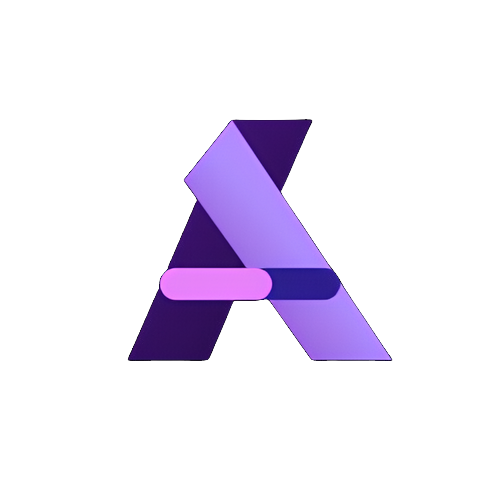

<p align="center">
  
</p>

<h1 align="center">AniShows</h1>

<p align="center">
  <strong>An open-source anime tracking, discovery, and community platform.</strong>
</p>

<p align="center">
  
  
  
  
</p>

---

## Overview

AniShows is a full-stack platform for anime fans and communities. It brings together anime discovery, personal watch tracking, reviews, social profiles, forums, notifications, and admin tooling in one open-source codebase.

Built with Django, React, PostgreSQL, Redis, and Celery, AniShows is designed to be both a polished user product and a maintainable platform for real operations.

<!-- Add product screenshots or GIFs here. Suggested: home, anime detail, profile, forums, admin dashboard. -->

## Features

- Browse seasonal, trending, top-rated, and scheduled anime.
- Track watch status, episode progress, rewatches, favorites, and personal history.
- Write spoiler-aware reviews with ratings, comments, reactions, and moderation tools.
- Build social profiles with follows, badges, activity, avatars, banners, and privacy controls.
- Discuss shows through forums with threads, nested posts, likes, and cached counters.
- Sync and enrich catalog data through AniList, Jikan, offline catalog imports, and background jobs.
- Manage the platform with admin dashboards, reports, logs, import jobs, backups, metrics, and load-test tooling.

## Stack

- **Backend**: Django, Django REST Framework, Channels, Celery.
- **Frontend**: React, Vite, React Router, TanStack Query, Tailwind CSS.
- **Data**: PostgreSQL, Redis, S3-compatible media storage.
- **Ops**: Docker Compose, Caddy, Gunicorn, Daphne, Sentry, Prometheus, k6.

## Architecture

```text
React + Vite
    |
Django REST Framework + Channels
    |
PostgreSQL + Redis + Celery workers
```

## Repository

```text
apps/                    Django apps and service layers
frontend/                React application
docs/                    Operations and scaling notes
monitoring/load-tests/   k6 benchmark scenarios
backups/                 Backup, restore, export, and import scripts
root/                    Django project settings and runtime entrypoints
```

## Local Development

```bash
cp .env.example .env
make build
make up          # web, celery, beat, frontend, db, redis, minio (migrations run on start)
make superuser
```

Everything is served through Vite at <http://localhost:5173>:

- App: <http://localhost:5173>
- API: <http://localhost:5173/api/v1/> (docs at `/api/docs/`)
- Django admin: <http://localhost:5173/django-admin/>

Backend and frontend sources are bind-mounted, so code changes hot-reload.
Restart Celery after changing task code: `docker compose restart celery`.

Optional services (compose profiles):

| Profile | Services | When |
|---|---|---|
| `jikan` | self-hosted Jikan + MongoDB + Typesense | `api.jikan.moe` is unreachable from your network. Set `JIKAN_BASE_URL=http://jikan:8080/v4`. |
| `analytics` | Umami | Working on analytics |
| `proxy` | Caddy on :80 | Testing prod-like routing |
| `backup` | Backup scheduler | Testing backup scripts |

```bash
docker compose --profile jikan up -d
```

Production uses the standalone `docker-compose.prod.yml` and is deployed by `deploy-prod.sh`.

## Documentation

- [Backups](docs/backups.md)
- [Celery](docs/celery.md)
- [API benchmarking](docs/api-benchmarking.md)
- [Production scaling plan](docs/scaling/100k-production-plan.md)

## Contributing

Contributions are welcome.

```bash
make test
make lint
```

## License

AniShows is released under the [MIT License](LICENSE).
